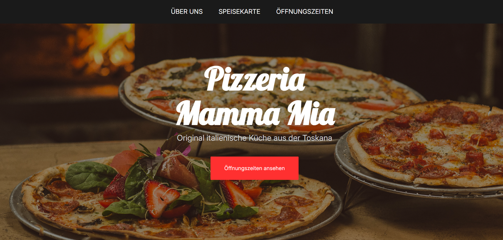
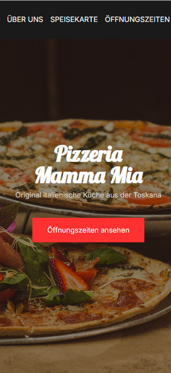

# Pizzeria Mamma Mia 🍕

A restaurant website built with HTML and CSS.

The website presents a fictional Italian restaurant, including an about section, opening hours and contact information.

## Preview

### Desktop

### Mobile

## What I practised

- Building layouts with Flexbox
- Making a website responsive with CSS media queries
- Using CSS variables and reusable classes
- Adjusting layouts for mobile and desktop screens

## Built with

- HTML
- CSS

## Getting started

Clone the repository and open `index.html` in your browser.

---

A small project to practise HTML, CSS and responsive web design.
